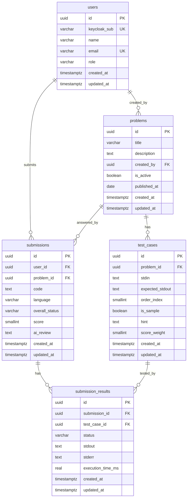

# DB スキーマ設計（確定版）

## 設計判断ログ

| # | 質問 | 決定事項 |
|---|---|---|
| Q1 | role 管理をどこで行うか | **アプリ側で管理**。Keycloak はメンバー認証のみ（LC 所属確認）。認可はアプリの `users.role` で行う |
| Q2 | 複数回提出を許可するか | **全提出を保存する** |
| Q3 | score の計算方法 | `floor(通過テストケース数 / 総テストケース数 × 100)`（0〜100 の整数） |
| Q4 | タイムスタンプ管理 | **全テーブルに `created_at` / `updated_at` を付与**。`problems` には保存日と別に `published_at date` も持つ |
| Q5 | テストケースの公開方針 | `is_sample` で公開/非公開を制御。**`hint` カラムを nullable で追加**（任意記入のため管理者負荷なし。書けば学生に表示、省略可） |
| Q6 | AI レビューの格納 | `submissions.ai_review text NULL` として予約。非同期実装時に利用開始 |

---

## テーブル定義

### `users`

| カラム名 | 型 | 制約 | 説明 |
|---|---|---|---|
| `id` | `uuid` | PK | アプリ内部 ID |
| `keycloak_sub` | `varchar(255)` | UNIQUE, NOT NULL | Keycloak の Subject ID（JWT の `sub`）。初回ログイン時にプロビジョニング |
| `name` | `varchar(100)` | NOT NULL | 表示名 |
| `email` | `varchar(255)` | UNIQUE, NOT NULL | メールアドレス |
| `role` | `varchar(20)` | NOT NULL, DEFAULT `'student'` | `'student'` \| `'admin'` |
| `created_at` | `timestamp with time zone` | NOT NULL, DEFAULT NOW() | |
| `updated_at` | `timestamp with time zone` | NOT NULL, DEFAULT NOW() | |

---

### `problems`

| カラム名 | 型 | 制約 | 説明 |
|---|---|---|---|
| `id` | `uuid` | PK | |
| `title` | `varchar(200)` | NOT NULL | 問題タイトル |
| `description` | `text` | NOT NULL | 問題文（Markdown） |
| `created_by` | `uuid` | FK → users.id, NOT NULL | 作成した管理者 |
| `is_active` | `boolean` | NOT NULL, DEFAULT `false` | 公開フラグ |
| `published_at` | `date` | NULL | 公開日（DB 保存日とは別管理。毎日問題の日付スケジューリング用） |
| `created_at` | `timestamp with time zone` | NOT NULL, DEFAULT NOW() | |
| `updated_at` | `timestamp with time zone` | NOT NULL, DEFAULT NOW() | |

---

### `test_cases`

`problems` との 1:N 関係。問題ごとに最大 10 件。

| カラム名 | 型 | 制約 | 説明 |
|---|---|---|---|
| `id` | `uuid` | PK | |
| `problem_id` | `uuid` | FK → problems.id, NOT NULL | |
| `stdin` | `text` | NOT NULL | 標準入力 |
| `expected_stdout` | `text` | NOT NULL | 期待する標準出力 |
| `order_index` | `smallint` | NOT NULL | 採点順（1〜10） |
| `is_sample` | `boolean` | NOT NULL, DEFAULT `false` | `true` ならサンプルとして問題文に表示 |
| `hint` | `text` | NULL | ヒント文（任意。記入時のみ学生に表示） |
| `score_weight` | `smallint` | NOT NULL, DEFAULT `1` | 配点の重み（将来用。現在は全て 1） |
| `created_at` | `timestamp with time zone` | NOT NULL, DEFAULT NOW() | |
| `updated_at` | `timestamp with time zone` | NOT NULL, DEFAULT NOW() | |

**制約**: `(problem_id, order_index)` に UNIQUE 制約。

---

### `submissions`

| カラム名 | 型 | 制約 | 説明 |
|---|---|---|---|
| `id` | `uuid` | PK | |
| `user_id` | `uuid` | FK → users.id, NOT NULL | |
| `problem_id` | `uuid` | FK → problems.id, NOT NULL | |
| `code` | `text` | NOT NULL | 提出コード |
| `language` | `varchar(30)` | NOT NULL, DEFAULT `'python'` | 将来の多言語対応用 |
| `overall_status` | `varchar(10)` | NOT NULL | `'Pass'` \| `'Fail'` \| `'Error'` |
| `score` | `smallint` | NOT NULL, DEFAULT `0` | 0〜100。意図的非正規化（後述） |
| `ai_review` | `text` | NULL | AI レビュー文（将来実装） |
| `created_at` | `timestamp with time zone` | NOT NULL, DEFAULT NOW() | 提出日時 |
| `updated_at` | `timestamp with time zone` | NOT NULL, DEFAULT NOW() | AI レビュー書き込み時などに更新 |

**インデックス**: `(problem_id, score DESC, created_at ASC)` — ランキング集計用

---

### `submission_results`

`submissions` との 1:N 関係。テストケースごとの実行結果。

| カラム名 | 型 | 制約 | 説明 |
|---|---|---|---|
| `id` | `uuid` | PK | |
| `submission_id` | `uuid` | FK → submissions.id, NOT NULL | |
| `test_case_id` | `uuid` | FK → test_cases.id, NOT NULL | どのテストケースで落ちたか追跡可能 |
| `status` | `varchar(10)` | NOT NULL | `'Pass'` \| `'Fail'` \| `'Error'` |
| `stdout` | `text` | NOT NULL | 実際の標準出力 |
| `stderr` | `text` | NOT NULL | 標準エラー出力 |
| `execution_time_ms` | `real` | NOT NULL | 実行時間（ミリ秒） |
| `created_at` | `timestamp with time zone` | NOT NULL, DEFAULT NOW() | |
| `updated_at` | `timestamp with time zone` | NOT NULL, DEFAULT NOW() | |

**制約**: `(submission_id, test_case_id)` に UNIQUE 制約。

---

## ER 図

---

## 正規化の確認（第 3 正規形）

| テーブル | 判定 | 備考 |
|---|---|---|
| `users` | ✓ 3NF | 全非キー属性が PK のみに関数従属 |
| `problems` | ✓ 3NF | `description` は `title` に従属しない |
| `test_cases` | ✓ 3NF | `(problem_id, order_index)` に UNIQUE 制約で複合一意性を保証 |
| `submissions` | △ 意図的非正規化 | `score` は `submission_results` から導出可能だが、ランキング集計コスト削減のため保持。提出時にアプリ側で計算・書き込む |
| `submission_results` | ✓ 3NF | `(submission_id, test_case_id)` UNIQUE 制約で重複防止 |

---

## MVP 実装フェーズ

| フェーズ | 対応テーブル | 備考 |
|---|---|---|
| **フェーズ 1（現在）** | `problems`, `test_cases`, `submissions`, `submission_results` | 認証なし。`user_id` は NULL 許容または仮 ID |
| **フェーズ 2** | `users` 追加、Keycloak 連携 | `keycloak_sub` でプロビジョニング。`user_id` NOT NULL 化 |
| **フェーズ 3** | `ai_review` 非同期書き込み、ランキング API | `submissions.updated_at` を AI 書き込みのタイミングで更新 |
